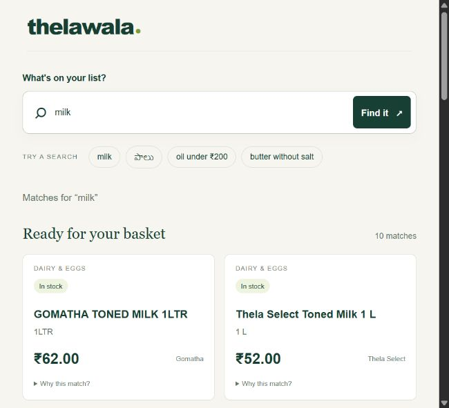

# Thelawala Search

An offline grocery search engine for the supplied Hyderabad catalog. It understands common regional names and typing mistakes, respects brand/price/pack-size intent, and returns only confirmed in-stock products in its primary results. A single search page and the required JSONL batch runner use the same engine.

**Stack:** Python 3.12+ standard library, HTML, CSS, and vanilla JavaScript. No API keys, database service, model download, npm, or pip dependencies. The repository is run directly from its root; installation as a Python package is not required.

## Quick start

Open a terminal **inside this repository** (the folder containing this README):

```sh
python --version
python -m thelawala serve
```

Open **http://127.0.0.1:8000**. On Windows, `py -3.12` can replace `python` if needed. Stop the server with Ctrl+C; choose a different port with `serve --port 8001`.

Try `milk`, `milk chocolate`, `godavari milk`, `panner`, `పాలు`, `oil under 200`, `butter without salt`, and `atta 5kg`. Try `onion` too: in this snapshot actual onions are unavailable or unconfirmed, so the page shows them separately instead of substituting onion-flavoured chips.



### Batch: the submission contract

```sh
python -m thelawala batch examples/queries.txt
python -m thelawala batch examples/queries.txt --output artifacts/results.jsonl
```

The default output is `results.jsonl` in the current directory. Input is UTF-8, one query per line. Output has exactly these two fields, with up to ten unique catalog IDs, best first:

```json
{"query": "customer query", "results": ["sku_id_1", "sku_id_2"]}
```

That JSON illustrates the schema; actual sample results are checked into [examples/results.sample.jsonl](examples/results.sample.jsonl). Blank input lines produce an empty result list. Repeated queries and their order are preserved. No-match queries produce `[]`; results are never padded. A trailing newline is not an extra query. Output is replaced atomically only after successful processing. Input and output must differ. Queries are limited to 500 characters.

### Other commands

```sh
python -m thelawala search "oil under 200"
python -m thelawala search "onion" --include-unavailable
python -m thelawala audit
python -m thelawala --no-logs search "milk"
python -m thelawala --data-dir path/to/data --as-of 2026-10-12 search "milk"
python -m thelawala --help
```

Global options (`--data-dir`, `--as-of`, `--no-logs`) go **before** the subcommand. A custom data directory must contain the same three filenames/schemas as the supplied data. `--no-logs` allows running without a search log. The default reference date is **12 Oct 2026**, as specified in the assignment, rather than the computer's clock. Log signals only use dates before that reference date.

## Project layout

```text
Thelawala-Search-Assignment/
├── README.md                    # Setup, operation, approach, tradeoffs
├── AI_USAGE.md                  # Actual AI assistance and mistakes found
├── pyproject.toml               # Project metadata and Python requirement
├── requirements.txt             # Documents the zero-dependency runtime
├── emails.md                    # Original client email thread
├── Take_Home_Assignment_Thelawala_Search.md
├── thelawala-search-data/        # Original input files, unchanged
│   ├── catalog.csv
│   ├── inventory.csv
│   └── search_log.jsonl
├── config/
│   └── synonyms.json            # Regional aliases, units, common phrases
├── thelawala/
│   ├── __main__.py              # CLI dispatch and user-facing errors
│   ├── models.py                # Product, query, and result records
│   ├── text.py                  # Unicode-safe normalization
│   ├── query.py                 # Brands, typos, prices, sizes, synonyms
│   ├── data.py                  # Validation, stock joins, price checks
│   ├── behavior.py              # Bounded signal from historical actions
│   ├── search.py                # Inverted retrieval and deterministic ranking
│   ├── batch.py                 # Atomic JSONL runner
│   ├── web.py                   # Local HTTP server and JSON endpoint
│   ├── evaluate.py              # Reproducible quality/latency evaluation
│   └── static/                  # HTML, CSS, JavaScript; no external assets
├── tests/                       # unittest tests for behavior and contracts
├── evaluation/
│   ├── cases.json               # Human-authored behavior assertions
│   ├── report.json              # Measured quality and latency
│   ├── data_audit.json           # Reproducible snapshot findings
│   └── scale_report.json         # Synthetic 20,000-product smoke test
├── scripts/
│   └── benchmark_scale.py
├── examples/
│   ├── queries.txt
│   └── results.sample.jsonl
└── docs/
    ├── DECISIONS.md             # Conflicting requests and explicit choices
    ├── DATA.md                  # Inferred dictionary and data-quality findings
    └── DEMO.md                  # Walkthrough, changes, and submission checklist
```

## How search works

1. **Load and validate.** Join catalog and inventory by `sku_id`. Reject duplicate IDs and malformed core fields. Retain raw prices; convert `metro_feed` amounts from assumed paise to rupees using `Decimal`. Flag unusual prices without guessing replacements. Original files are not rewritten.
2. **Normalize and index.** Preserve Unicode combining marks, normalize whitespace/case, expand unit abbreviations, and repair a few observed catalog spelling errors. Strip the product's own brand and pack-size text from its identity. Build an in-memory inverted token index and brand index.
3. **Interpret the query.** Expand general aliases such as `pesara pappu → moong dal`; conservatively repair unknown tokens against the catalog vocabulary. Recognize full or unique partial catalog brands, price bounds, explicit pack sizes, and `cheap`. Known words are not fuzzily rewritten.
4. **Retrieve.** Intersect postings for **all** query terms and any requested brand. Apply price and size constraints. Missing stock is unknown; discontinued and unavailable products never enter primary results. No description matching is used: most descriptions are generic and many are missing.
5. **Rank.** Product-type intent comes first. Within a tier, score token rarity (IDF), identity length, phrase matching, a capped query-specific behavior signal (at most 0.35), and a small Thela Select preference (0.04, only without a requested brand). Final ties use SKU ID. This is an explainable lexical score, not a trained model or full BM25 implementation.
6. **Return.** Deduplicate exact normalized brand/identity/size matches without merging inventory quantities. The page can show up to ten additional unavailable matches in a separate section; batch output contains only primary results.

For generic ingredients such as `milk`, `onion`, `butter`, and `oil`, incompatible product identities are excluded rather than used as filler. `milk` cannot become milk rusk or chocolate; `oil` means edible oil rather than hair oil or oil-control face wash. This conservative policy reduces recall for some vague queries but avoids misleading results. More specific queries still work.

`cheap shampoo` sorts by **total pack price** within the product-intent tier; it does not mean cheapest per ml. `under 200` is strictly less than ₹200; `up to 200` is inclusive. `between 100 and 200` includes both endpoints. Prices refer to the total pack. `atta 5kg`, `milk 0.5ltr`, and `eggs 30` constrain the pack size. A bare `atta 5` remains ambiguous and gets a warning instead of an invented unit.

### Using customer activity carefully

The log contains search actions, browsing, positions, and sponsorship. All sponsored events are ignored. Cart additions carry more weight than clicks (3 vs 1). Browse recovery after zero results has half weight; browsing after successful search has only 0.15 weight. A small capped position adjustment and 45-day half-life reduce obvious skew; they are heuristics, not a statistically corrected click model. Behavior is query-specific, bounded, and can never introduce a product that failed retrieval or hard constraints.

## Decisions and data issues

The team disagrees about unavailable stock, own-label priority, and popularity. The decisions are explicit in [docs/DECISIONS.md](docs/DECISIONS.md). Important findings:

- 1,102 catalog products, 1,070 inventory rows, 6,578 logged searches.
- 41 catalog products have no inventory; 9 inventory IDs have no catalog entry.
- 898 catalog products have positive active stock; 81 are active with zero stock; 82 are discontinued.
- 360 descriptions are missing. Product naming and size formatting vary by supplier.
- `metro_feed` prices strongly suggest paise; this is an inference, not a confirmed currency contract.
- 17 prices are flagged by conservative checks, including apples, lemons, and multipiece soap packs. Flagged products remain discoverable with **Price under review**; they are excluded from budget/cheap queries.
- 23 restock estimates predate the reference date. These are shown as expired, never as current promises.
- 2,782 searches returned zero results (~42%). This historical rate is not the new engine's measured failure rate.

See [docs/DATA.md](docs/DATA.md) and [evaluation/data_audit.json](evaluation/data_audit.json) for details.

## Verification and measured results

```sh
python -m unittest discover -s tests -v
python -m thelawala evaluate --output evaluation/report.json
python scripts/benchmark_scale.py --products 20000 --output evaluation/scale_report.json
```

Tests exercise the actual data, all 1,446 unique raw log queries for availability invariants, synthetic bias/cutoff cases, batch Unicode/blanks/duplicates/atomic failure, and the real HTTP handler. There are **18 test methods** and **63 curated behavior cases**. The curated cases were written during development; passing them is regression evidence, not a blind accuracy estimate.

Temporal evaluation trains behavior on dates **before 1 Oct**, then evaluates eligible non-sponsored cart additions from **1–10 Oct** (the available test dates). Cross-boundary sessions are excluded. On 270 raw query strings with eligible positives:

| Method | Hit rate @10 | MRR @10 |
|---|---:|---:|
| Literal substring baseline | 52.59% | 0.3964 |
| Interpreted lexical search, no behavior | 81.48% | 0.4162 |
| Same search plus pre-October behavior | 82.96% | 0.5468 |

Hit rate asks whether any logged positive is in the first ten; MRR rewards placing the first positive earlier. Matching normalized duplicate identities counts as a hit. The report includes reproducible first-pass and warm latency, environment information, and limitations. Runtime timings vary by machine and load.

The checked-in Windows/Python 3.12.10 run measured about **430 ms startup**, **2.22 ms first-pass p95**, and **1.29 ms warm p95** over all 1,446 raw query strings. The synthetic 20,000-product run measured **2.83 s startup** and **49.56 ms p95** over 189 searches. These are local process timings, not network latency or a concurrent-load SLA.

**Limitations:** cart actions are incomplete relevance labels from the old interface. There are no full impression lists, purchases, or historical inventory snapshots. Current-stock filtering makes this a constrained proxy, and held-out logs do not prove production conversion gains. No real 20k catalog is supplied; the separate scale benchmark repeats the original vocabulary to measure candidate-volume scaling only.

## Daily updates and operating scope

Replace the three input files with a validated, consistent snapshot and restart the process. All normalized records, index postings, price flags, and behavior aggregates rebuild automatically; there are no per-SKU answer tables or generated files to hand-edit. A running process serves its startup snapshot and does not watch files. The curated synonym dictionary and price policies are maintained rules, not learned automatically from new products.

The server binds to `127.0.0.1` and is a local demo, not a production internet server. It serves only its three named assets and JSON endpoints, has no third-party fonts/scripts, renders data through `textContent`, and does not log query strings. `GET /api/search?q=...` exposes detailed primary and unavailable results; `GET /api/health` reports the snapshot date and loaded product count.

The index uses memory proportional to product tokens plus aggregated log signals. Query retrieval intersects token/brand postings rather than scanning every description. Large logs are streamed and aggregated on startup; a production pipeline should persist aggregates and build/swap snapshots away from the serving process.

## What I would do next

1. Confirm supplier price units, fix source-data errors, and define warehouse freshness guarantees.
2. Collect human relevance judgments for ambiguous and multilingual queries; record full impressions and purchases before learning a ranker.
3. Add catalog-driven product taxonomy and broader language coverage. Curated aliases do not understand arbitrary Telugu/Hindi or every spelling error.
4. Evaluate a real 20k catalog, concurrent traffic, and memory use. Replace the small fuzzy vocabulary scan with a dedicated spelling index if measured cost warrants it.
5. Add validated snapshot refresh with atomic swaps and a production HTTP server if the demo becomes a service.

## Submission

The assignment asks for a **Git repository link**, code history, this README, and [AI_USAGE.md](AI_USAGE.md). The work is committed locally; no GitHub repository was created or pushed because the user requested local-only preparation. [docs/DEMO.md](docs/DEMO.md) covers publishing, reviewer access, and a live walkthrough. Local commits made by the assistant are attributed to `Codex <codex@localhost>` rather than claiming to be manually authored by the candidate.
